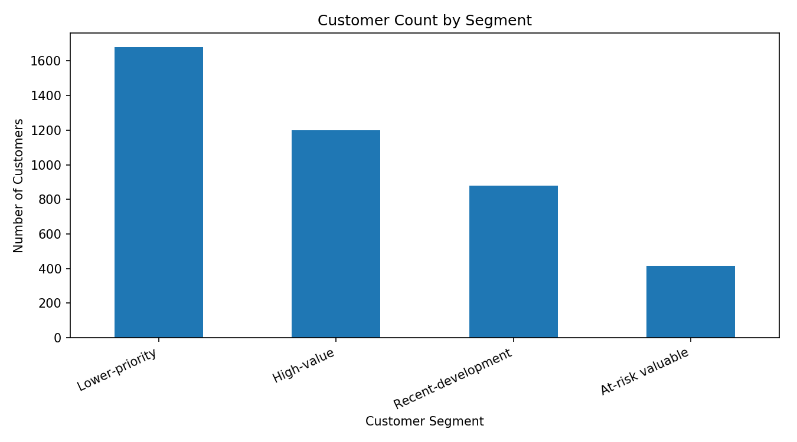
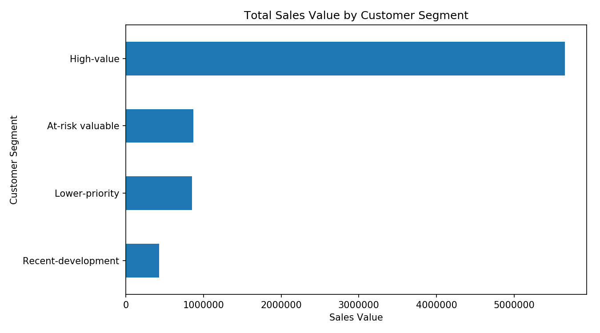

# Retail Customer RFM Segmentation

## Project Overview

This personal project uses RFM analysis to group retail customers based on purchase recency, frequency and monetary value.

## Business Objective

To identify customer groups with different purchasing patterns and develop potential retention, development and reactivation actions.

## Data Source

UCI Machine Learning Repository: Online Retail dataset.

The analysis uses the cleaned transaction data prepared in the related retail sales analysis project.

## Analysis Period

January to November 2011.

## Methods

1. Excluded transactions without CustomerID values.
2. Calculated Recency, Frequency and Monetary metrics for each identified customer.
3. Converted the metrics into relative scores from 1 to 4.
4. Applied documented rules to create customer segments.
5. Compared customer counts and sales value across segments.

## Key Findings

- The analysis included 4173 identified customers.
- The largest customer segment by customer count was Lower-priority.
- The highest-sales-value segment was High-value.

## Limitations

- Customers without CustomerID values were excluded.
- Monetary represents sales value, not profit.
- The segments are based on relative scores within this dataset.
- The analysis does not prove which customers will churn or respond to marketing.
- Additional customer, cost and campaign-response data would be needed to evaluate marketing effectiveness.

## Tools

- Python
- pandas
- Matplotlib
- Jupyter Notebook
## Visualisations

